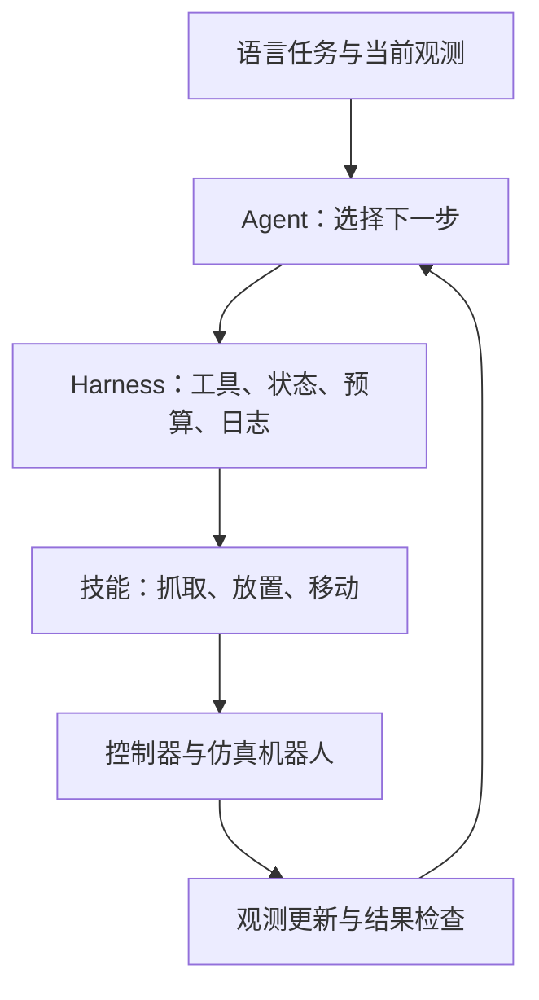

# Robot Agent Manipulation 入门路线：从 ROS / 机械臂到 Agent + Harness

更新日期：**2026-10-19**。适用对象：已有 ROS、坐标变换、机械臂运动规划或控制基础，准备先用仿真学习机器人 agent 的开发者。

目标是在八周左右完成一个能调用操作技能、检查执行结果、从失败中恢复的机器人 agent，再加入可验证的技能学习。计划假设每周投入 10–15 小时；这是学习安排，不是已经复现的实验结果，也不保证特定成功率。

- [概念与系统边界](#概念与系统边界)
- [项目与技术栈](#项目与技术栈)
- [八周计划](#八周计划)
- [工具与执行反馈](#工具与执行反馈)
- [如何证明系统学到了技能](#如何证明系统学到了技能)
- [阅读顺序](#阅读顺序)
- [第一周交付清单](#第一周交付清单)

相关文档：[仓库首页](../README.md) · [参考架构](reference-architecture.md) · [本次来源与核验范围](../sources/agent-manipulation-roadmap-2026-10-19.md)。

## 概念与系统边界

### Agent + Harness 在路线图中的位置

Agent + harness 是机器人操作中一条活跃的研究路线。[Thea](https://arxiv.org/abs/2608.11246) 探索工具编排、场景图和执行结果反馈；[Robo-Harness K1](https://arxiv.org/abs/2609.29389) 将深度、空间测量和抓取候选暴露为感知工具；[World Action Agent](https://arxiv.org/abs/2609.29964) 探索动作预演、视觉纠偏和可复用技能。这些论文提供设计参考，单凭这些近期预印本不能断言整个领域已经采用统一架构。

Vision-language-action（VLA，视觉语言动作）模型仍是并行发展的路线，例如 [openpi](https://github.com/Physical-Intelligence/openpi) 提供模型检查点及适配示例。Agent 的任务组织能力与 policy 的动作执行能力可以组合；先理解两者的接口，再决定训练哪部分。

| 组件 | 在入门项目中的职责 | 需要补的知识 |
| --- | --- | --- |
| Agent / vision-language model（VLM） | 根据目标和观测选择技能、处理执行反馈、更新计划 | 工具调用、结构化输出、上下文管理、闭环决策 |
| Harness | 管理工具、任务状态、执行预算、超时、日志和结果检查 | 接口契约、状态机、取消与恢复、轨迹记录 |
| Skill / policy | 把子目标转成动作；可以是脚本、规划器或学习策略 | 参数化技能、模仿学习、动作与观测表示 |
| Controller | 执行关节或末端目标 | 复用已有运动控制基础，明确坐标系、单位与控制模式 |
| Embodiment | 机器人身体及其传感器、夹爪、自由度和动作条件 | 相机与末端标定、工作空间、不同机器人之间的接口差异 |

下面是本项目建议采用的工程结构，并非所有系统的固定架构。Agent 按子任务作决策，控制器按自身的控制周期执行动作；不依赖每一次语言模型调用来维持伺服循环。



### 两种技能学习

| 层次 | 例子 | 可能变化的对象 | 如何检查改善 |
| --- | --- | --- | --- |
| 程序性技能 | 抓杯子前清空遮挡，失败后换观察角度 | 技能记录、可执行程序、检索与恢复规则 | 在未见布局或任务组合上比较有无技能库 |
| 动作策略 | 如何接近物体、闭合夹爪并稳定提起 | policy 参数、动作表示或控制参数 | 用独立测试回合比较训练前后的闭环执行 |

保存成功经验不会自动更新底层抓取策略。先做程序性技能和执行闭环，再训练一个动作技能，能够更容易判断失败来自决策、感知还是控制。初期不必同时引入多 agent、在线强化学习和完整世界模型。

## 项目与技术栈

### 贯穿项目：带失败恢复的桌面整理

用户给出语言目标，单臂机器人将指定刚体物体放入目标区域；遇到物体移位、第一次抓取失败或目标区域被占用时，重新观察并调整执行。

先完成单物体抓取放置，再增加多步任务。柔性物体、灵巧手、精密插装和双臂协作放到后续阶段。

| 环节 | 建议起点 | 使用边界 |
| --- | --- | --- |
| 环境与控制 | [robosuite](https://robosuite.ai/docs/basicusage.html) | 先选择一个单臂任务，固定相机、动作表示与控制器 |
| Agent | 一个支持视觉输入和结构化工具调用的模型 | 可先使用托管模型；记录模型版本、调用次数、延迟和费用 |
| Harness | 一个小型 Python 工具注册表和显式状态循环 | 先实现工具、状态、反馈、预算和记录；根据实际需求再引入编排框架 |
| 基础技能 | 参数化的脚本或控制器技能 | 先测可靠性，避免把技能本身的失败全归因于 agent |
| 动作学习 | [LeRobot ACT](https://huggingface.co/docs/lerobot/act) | 跑通示范、训练和闭环评测；需要适配仿真观测、动作与数据格式 |
| 标准化评测 | [LIBERO](https://github.com/Lifelong-Robot-Learning/LIBERO) | 采用该基准要求的环境版本、任务、初始状态和成功判据 |
| 后续 VLA 实验 | [openpi](https://github.com/Physical-Intelligence/openpi) | 先检查模型的算力、观测、动作和 embodiment 适配要求 |

工具列表不是已经验证可直接拼装的统一环境。特别是 LIBERO 与独立 robosuite 实验可能要求不同依赖版本，应按官方要求隔离环境，固定 commit、配置和依赖。训练 ACT 前先验证数据与仿真适配，不假设安装一个库就能自动控制任意环境。

已有 ROS 基础可以用于理解接口、状态与执行语义。前期允许直接调用仿真 Python 接口，等闭环稳定后再增加 ROS 2 adapter，比较不同执行后端。

## 八周计划

| 阶段 | 工作 | 验收产物 |
| --- | --- | --- |
| 第 1–2 周：可靠技能 | 跑通抓取放置，封装工具，随机化初始位置 | 基础技能成功次数 / 总次数、失败分类和回放 |
| 第 3–4 周：Agent 闭环 | 接入 VLM，执行后重新观察，检查子目标并恢复 | 多步任务记录，以及物体移位、抓取失败、目标占用三个测试 |
| 第 5–6 周：技能学习 | 加入技能记忆，再学习一个动作策略 | 有无技能库的比较、动作策略训练前后的独立评测 |
| 第 7–8 周：评测与分析 | 扰动、消融、未见布局和任务组合 | 可重复实验配置、结果表、失败案例和局限说明 |

### 第 1–2 周：工具与基础技能

1. 运行 robosuite 示例，理解 `reset`、`step`、观测、动作和成功判据。
2. 明确末端绝对位姿与增量动作的区别，记录坐标系、单位、夹爪开合约定及控制周期。
3. 实现单物体抓取放置，随后封装下文的五个工具。
4. 固定一组随机初始状态，测量基础技能成功率并保存失败视频。

初期可使用仿真真值排查控制问题，但需把它标记为 **oracle-state baseline**。再单独加入视觉定位，报告 **vision-based** 结果。训练、规划和评测分别能访问哪些状态，必须写进实验配置。

### 第 3–4 周：执行后重新决策

先使用单个 agent，按如下流程循环：读取新观测 → 选择工具 → 执行 → 检查结果 → 更新任务状态。对持续执行的技能，由 harness 管理运行、终止、取消与超时。

预先限制每回合的工具调用数、重复失败次数、仿真步数和模型调用预算，达到限制后返回可解释的终止状态。

至少构造三个测试：

- **物体移位**：上次定位后目标改变位置，agent 能否重新定位。
- **第一次抓取失败**：夹爪闭合但没有提起物体，agent 能否检查并修改参数或重新规划。
- **目标区域被占用**：agent 能否识别前置条件不成立，并选择预先定义的清理动作、其他可用目标或报告阻塞。

验收重点是新证据是否改变行为。反复执行同一失败动作不能算作恢复。

### 第 5–6 周：可复用经验与动作学习

每条程序性技能记录包含：**适用条件、参数、执行步骤、成功条件、失败原因、恢复方法、来源回合与版本**。使用开发回合生成候选技能，在验证集上检查效果和历史任务保留，再冻结用于最终测试；最终测试轨迹不回流更新技能库。

随后选择一个动作技能，跑通示范采集 → 数据检查 → ACT 训练 → 闭环执行 → 失败分析 → 补数据。LeRobot 官方将 ACT 推荐为入门策略，但它仍需与选定仿真环境适配。

可以把学习策略封装为 `execute_pick_policy()`，与脚本技能使用相同的执行结果契约。程序性技能与动作策略分开版本化，分别测量效果；降低训练损失不足以证明抓取能力改善。

### 第 7–8 周：固定协议后比较

冻结任务定义、初始状态、观测权限、预算和成功判据，再做下面的对照。遇到新的失败，可在开发阶段修改系统；修改后重新运行受影响的比较，不能只替换最好的一组结果。

## 工具与执行反馈

以下为建议的概念接口，不是 robosuite 或 LeRobot 的现成 API。

| 工具 | 输入 | 输出与检查 |
| --- | --- | --- |
| `observe()` | 视角或传感器选择 | 图像、机器人状态、时间戳、观测编号及数据来源 |
| `locate(object)` | 目标物体标识 | 位姿、坐标系、估计质量与失败原因；无法定位时明确返回失败 |
| `pick(object)` | 目标、抓取参数或技能版本 | 执行状态、失败原因、执行后观测和物体是否被提起的证据 |
| `place(target)` | 目标区域与容差 | 执行状态、物体是否落入区域、执行后观测 |
| `check(condition)` | 子目标或任务条件 | `true` / `false` / `unknown`，以及判据与观测证据 |

每次动作至少返回：**是否成功、失败原因、执行后的观测**。例如“夹爪闭合后物体仍在桌面”，比单独返回 `False` 更利于恢复。

执行结果可采用如下结构；字段和枚举应在项目中固定版本：

```json
{
  "episode_id": "eval-017",
  "tool_call_id": "call-004",
  "status": "failed",
  "reason": "object_not_lifted",
  "observation_id": "obs-005",
  "evidence": {
    "predicate": "object_lifted",
    "value": false,
    "source": "simulator_state"
  },
  "elapsed_sim_steps": 120
}
```

执行成功由明确的判据确认。仿真真值检查器可以作为评测参考；如果把检查结果提供给 agent，则它同时是 agent 可访问的信息，必须在比较中保持一致。视觉检查器也可能误判，应与独立参考判据比较，并保留 `unknown` 状态。

## 如何证明系统学到了技能

### 最小对照实验

| 比较 | 保持不变的条件 | 要回答的问题 |
| --- | --- | --- |
| 固定流程 vs agent 调度 | 相同工具、基础技能、观测权限和执行预算 | Agent 是否帮助处理任务变化 |
| 有无执行结果检查 | 相同模型、技能、初始状态及最终评测器 | 检查是否减少无效执行、提高任务成功率 |
| 有无技能记忆 | 相同模型、基础技能与测试任务 | 经验是否迁移到未见布局或任务组合 |
| 脚本技能 vs 学习策略 | 相同高层目标、任务分布及评测判据 | 学习策略在哪些条件下带来收益；数据与算力成本是多少 |

脚本与学习策略的比较不自动构成因果归因：需说明各自使用的观测、训练数据、调参预算与能力差异。

### 指标与实验纪律

- **任务成功率**：成功回合数 / 总回合数，使用预先固定的最终任务判据。
- **恢复成功率**：在规定扰动后恢复并完成任务的回合数 / 规定扰动回合数；同时记录恢复耗时和重试次数。
- **效率与成本**：仿真步数、实际完成时间、模型与工具调用次数、模型费用和人工介入次数。
- **失败分类**：目标定位、抓取或接触、工具参数、规划、错误成功判断、超时及预算耗尽。

初步比较可从每组 30–50 个回合开始，报告成功次数和总次数；这只是起步规模，不是统计充分性的保证。使用配对初始条件和扰动清单，分开开发、验证与最终测试，并根据不确定性决定是否增加回合。所有方法使用相同的 oracle-state 或 vision-based 权限；若权限不同，分表报告。

保留环境版本、机器人与相机配置、模型版本、提示与技能版本、随机种子、完整工具轨迹和回放。仿真中的暂停、重置或回滚能力需要明确标注，不能据此推断真实机器人也具备同样的恢复能力。

## 阅读顺序

下面按实现问题排序，不按论文数量或排行榜排序。前三项为研究设计参考，不能直接当作已复现结果或可安装的软件。

1. [Thea — Towards the Harness of Embodied Agents](https://arxiv.org/abs/2608.11246) — 阅读场景上下文、动作结束、成功判断和失败诊断之间的关系。
2. [Robo-Harness K1](https://arxiv.org/abs/2609.29389) — 阅读几何与感知工具的接口如何帮助 VLM 作出操作决策。
3. [World Action Agent](https://arxiv.org/abs/2609.29964) — 阅读动作预演、视觉纠偏，以及程序性技能与轨迹训练的区别。
4. [robosuite Basic Usage](https://robosuite.ai/docs/basicusage.html) 与 [Controllers](https://robosuite.ai/docs/modules/controllers.html) — 对照实现环境循环和动作接口。
5. [LeRobot ACT](https://huggingface.co/docs/lerobot/act) — 对照实现示范到动作策略的训练与评测。
6. [LIBERO](https://github.com/Lifelong-Robot-Learning/LIBERO) 与 [openpi](https://github.com/Physical-Intelligence/openpi) — 在已有闭环和指标后，分别扩展标准化评测与 VLA 实验。

## 第一周交付清单

- [ ] 固定仿真版本、机器人、任务、控制器与相机配置，跑通示例。
- [ ] 实现一个可重复运行的抓取放置流程。
- [ ] 写清观测、动作的坐标系、单位、控制模式及真值访问权限。
- [ ] 封装 `observe`、`locate`、`pick`、`place`、`check` 五个概念工具。
- [ ] 保存工具参数、结果、观测与失败视频。
- [ ] 对随机初始位置报告成功次数 / 总次数和失败分类，作为接入 agent 前的基线。

后续扩展应由失败证据驱动：定位失败优先改善感知，接触失败优先改善动作技能，任务组合失败再改善规划与记忆。先维持可解释、可重复的闭环，再扩大自主任务范围。
